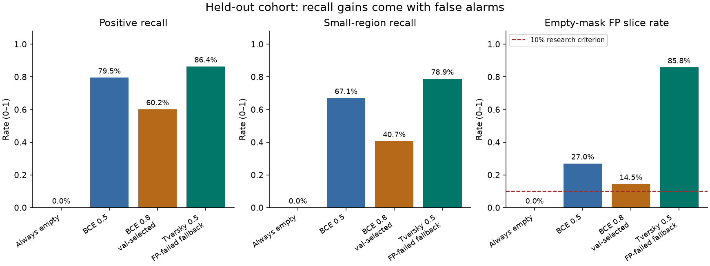

# NeuroGuard: when better MRI recall creates more false alarms

**AI + Health · Solo submission · My own research idea**

**Pitch:** NeuroGuard helps radiologists and medical imaging researchers examine brain MRI scans by highlighting potentially abnormal regions and comparing how different models balance detecting abnormalities against false alarms. **This project is a prototype and is not medical advice.**

## The problem

A review aid must balance missed annotated abnormalities against false alarms.
High pixel accuracy can hide missed foreground because almost every pixel is
background. No clinical benefit or diagnostic safety has been established here.

## What I built

I developed a local Gradio application that accepts an original 256 × 256, three-channel LGG MRI
TIFF and shows its FLAIR image, predicted binary mask and coloured overlay. Users
can compare BCE and Tversky U-Nets at frozen operating points. Arbitrary photographs,
DICOM studies and other MRI domains are unsupported. Inference requires the
authorised original checkpoints; no public deployment or weights are bundled.

## What I added

I asked whether a recall-oriented loss could improve detection of small annotated
regions without an unacceptable increase in false positives. My contribution is
the controlled loss comparison, patient-level split, size analysis and honest
failure analysis, rather than a claim that a U-Net itself is new.

## How it works

Mateusz Buda's LGG dataset v2 contains 3,929 image/mask pairs from 110 patients.
The frozen split uses 77/16/17 patients and 2,719/621/589 slices for training,
validation and test. Patients never cross splits. Both learned models use the
same 1,942,577-parameter U-Net, preprocessing, seed 42 and training/selection rules.
Only the loss differs: BCE versus per-slice Tversky (FP α=.3, FN β=.7, ε=1e−6).
I fixed size cutoffs from training and selected thresholds using validation alone.

## Results on 17 unseen test patients

| Approach (threshold) | Positive Dice | Recall | Small recall | Empty-mask FP rate |
|---|---:|---:|---:|---:|
| Always empty | 0.000 | 0.000 | 0.000 | 0.00% |
| BCE (0.5) | 0.767 | 0.795 | 0.671 | 27.02% |
| Tversky (0.5, fallback) | 0.777 | 0.864 | 0.789 | **85.79%** |
| BCE (0.8, validation-selected) | 0.670 | 0.602 | 0.407 | 14.48% |

Dice/recall average positive slices within each patient, then patients equally;
small recall restricts this calculation to small annotations. FP rate is the
fraction of 359 empty-mask slices with any predicted foreground. Always-empty
achieved 98.97% pixel accuracy despite zero positive Dice/recall.

**My hypothesis is only partially supported.** At 0.5, Tversky improved recall
by 6.84 percentage points (95% paired patient-bootstrap interval 3.41–10.47) and
small-region recall by 11.79 pp (4.95–19.97), with severe false positives. The Dice
difference interval, −1.96 to +3.87 pp, does not firmly establish superiority.
BCE 0.8 met the 10% validation FP research criterion but failed it on test;
Tversky met it on neither. I reviewed missed small regions and foreground predicted on empty-mask slices.

## Limits and next steps

One split, one seed, 2D slices and a small cohort limit generalisation; there is
no external, demographic fairness or clinical validation. Next, I would investigate false-positive suppression and external validation
under a new protocol.

## Sources and assistance

[Dataset](https://www.kaggle.com/datasets/mateuszbuda/lgg-mri-segmentation)
([CC BY-NC-SA 4.0](https://creativecommons.org/licenses/by-nc-sa/4.0/));
[U-Net](https://arxiv.org/abs/1505.04597), [Tversky](https://arxiv.org/abs/1706.05721),
[PyTorch](https://pytorch.org/), [Gradio](https://www.gradio.app/).
I directed the experimental design, model comparison and analysis. I used
[OpenAI ChatGPT](https://chatgpt.com/) and [Codex](https://openai.com/codex/)
to accelerate implementation, debugging, testing and documentation. Results come
from my completed Colab experiments. [Full credits](docs/sources-and-licensing.md).

---

## Application, notebook and reproduction

The write-up above is the **official submission write-up**. Start with the
[final research notebook](notebooks/NeuroGuard_Final_Submission.ipynb) for saved
tables, uncertainty, size analysis and reviewed failure descriptions. The
[exact aggregate results and provenance](results/final-summary.json) retain the
original report hashes. No research experiment is rerun by the results readout.



## Run the Gradio application locally

With PyTorch installed in a project virtual environment:

```powershell
.\.venv\Scripts\python.exe -m pip install -r requirements-demo.txt
.\.venv\Scripts\python.exe app.py
```

Open **http://127.0.0.1:7860**. CPU is the default. Upload a single original
**256 × 256 × 3 uint8 LGG TIFF**, at most **4 MiB**, confirm compatibility and
choose a frozen operating point. The app displays stored FLAIR channel 1,
a lossless binary mask and a coloured overlay. Comparison modes use the same
input. JPEG/PNG photographs, DICOM studies, volumes and other MRI domains are
unsupported. File structure checks cannot establish medical provenance.

**The original model weights and sample MRI images are private and not bundled.**
Independent inference requires the authentic checksum-verified checkpoints in
ignored `local-assets/`. The local address is **not a public deployment**.
Judges can read and re-execute the saved-aggregate notebook without personal Drive
access. See [installation, weight paths and exact smoke-test steps](docs/demo.md).

## Methodology and checks

[Reproduction and original research record](docs/reproduction.md) ·
[Frozen evaluation protocol](docs/evaluation-protocol.md) ·
[Sources, AI assistance and licensing](docs/sources-and-licensing.md).

The four original research notebooks, configurations and experimental evidence
are preserved. MRI failure panels remain private; their reviewed observations
are described in the final notebook. No diagnostic confidence score is reported.

```powershell
.\.venv\Scripts\python.exe -m pytest -q
.\.venv\Scripts\python.exe -m pip check
```

Tests use synthetic data/weights and do not measure MRI performance. Genuine
local application checks on positive-mask and empty-mask TIFF examples also
verified upload-to-output parity at the three frozen operating points; these are
application smoke tests, not a repetition of the held-out evaluation.
